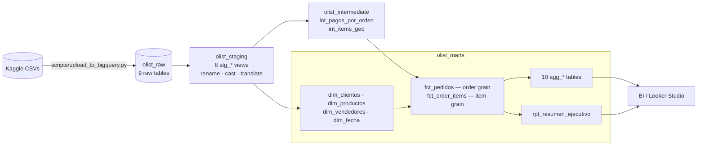

# Olist E-Commerce Analytics — dbt + BigQuery

[](https://github.com/santipigretti-ssp/Proyecto-dbt/actions/workflows/ci.yml)

End-to-end ELT pipeline that turns ~100k raw orders from **Olist**, Brazil's largest
marketplace, into a tested star schema and BI-ready aggregates. It goes beyond plumbing:
every mart answers a specific business question, and the findings below were derived from them.

**Stack:** dbt Core 1.11 · BigQuery · dbt-utils · Python (ingestion) · sqlfluff · GitHub Actions

**At a glance:** 27 models · 190 data tests · 10 aggregates, each designed for a specific chart ·
revenue reconciled across every mart on every build

---

## Key findings

All numbers are reproducible with `dbt build` and a query against the marts.

### 1. The delivery bottleneck is the courier, not the seller

Splitting delivery time into its three legs (`fct_pedidos`, `agg_estados_cliente`):

| Leg | Owner | Days | Share |
|---|---|---|---|
| Purchase → payment approved | Platform | 0.41 | 3% |
| Approved → handed to carrier | **Seller** | 2.78 | 22% |
| Carrier → customer | **Courier** | 9.31 | **75%** |

Even if sellers shipped instantly, delivery would only drop from 12.5 to 9.7 days. This
analysis needs `order_approved_at` and `order_delivered_carrier_date`, two columns most
public projects on this dataset drop in staging.

### 2. Operations broke down twice, and both times it was the courier

`agg_operacion_mensual` shows two episodes that a yearly average hides completely:

| Purchase month | Courier transit (days) | Seller handling (days) | Promise buffer (days) | Late rate | Review score |
|---|---|---|---|---|---|
| 2017-10 (baseline) | 8.4 | 3.0 | 11.9 | 5.3% | 4.21 |
| 2017-11 (Black Friday) | 11.1 | 3.6 | 8.1 | **14.3%** | 3.99 |
| 2018-02 | 13.4 | 3.1 | 8.3 | **16.0%** | 3.88 |
| 2018-03 | 12.9 | 3.0 | 6.4 | **21.4%** | 3.81 |
| 2018-06 (recovered) | 6.7 | 2.2 | 19.2 | 1.4% | 4.31 |

Seller handling barely moved. Courier transit jumped ~60% while the promised dates did not
adapt, so the buffer shrank and late deliveries tripled or worse.

### 3. Satisfaction falls off a cliff the day after the promised date

`agg_puntualidad_satisfaccion` plots the review score against days relative to the promised date:

| Delivered | 10 days early | On the date | 1 day late | 3 days late | 7 days late |
|---|---|---|---|---|---|
| Avg. score | 4.33 | 4.04 | 3.73 | 2.68 | 1.92 |
| Negative reviews (1–2★) | 8% | 12% | 20% | **50%** | 73% |

Arriving early lifts the score only modestly (+0.3). Each day late costs 0.3–0.5 points, and
by day 3 half of the reviews are negative. **The promise date is the product.**

### 4. Distance degrades everything, and one route underperforms its distance

| Distance (`fct_pedidos.bucket_distancia`) | Orders | Freight | Days | Late | Score |
|---|---|---|---|---|---|
| Local (<100 km) | 17,803 | R$ 13.33 | 6.4 | 6.4% | 4.28 |
| Regional (100–500 km) | 36,967 | R$ 20.96 | 11.4 | 7.2% | 4.18 |
| National (500–1,500 km) | 32,440 | R$ 25.38 | 14.8 | 8.7% | 4.10 |
| Long haul (1,500 km+) | 8,792 | R$ 39.95 | 20.5 | 13.1% | 4.00 |

The route matrix (`agg_rutas_logisticas`) shows that distance is not the whole story.
**São Paulo → Rio de Janeiro** (443 km, 8% of all orders) takes 16.2 days with a 15.5% late
rate, while São Paulo → Minas Gerais (496 km) takes 12.3 days with 6.4% late. The gap is entirely
courier transit (12.9 vs 9.1 days). It is the single highest-impact corridor to renegotiate.

### 5. The 91.9% on-time rate is flattering

- Promised dates carry an average **11.9-day buffer** (~24 days promised to deliver in 12.5).
- Counting cancelled and undelivered orders (no survivorship bias), on-time drops to **89.7%**.
- p90 delivery time is **23 days**.

High on-time comes from over-promising, not from fast delivery. Finding 3 shows why that
trade-off exists, and finding 2 shows how fragile it is.

### 6. Growth stalled in 2018

Month-over-month revenue (`agg_ventas_mensual.ingresos_mom_pct`): +27% (Jan), −11%, +15%,
+2%, +0.4%, −12%, +1% (Jul). The level curve keeps rising, so a dashboard that shows only
the level hides the plateau. That is why the mart ships the variation as a column.

### 7. It's a one-purchase business: retention is ~0.5%, not a truncation artifact

The dataset ends in 2018-08, so recent customers had no time to come back.
`agg_cohortes_retencion` checks only cohorts with 13–18 months of history: month-1 retention
stays at **0.2–0.6%**. In 2018, 97–98% of each month's buyers were first-time customers. The lever is
acquisition cost, not loyalty programs.

### 8. As a marketplace, the real business is ~10x smaller than GMV

GMV is **R$ 15.42M**, but Olist earns a commission on it. With declared, parameterized
assumptions (15% commission, 3% payment processing; `vars` in `dbt_project.yml`),
`agg_take_rate` estimates a **R$ 1.52M platform margin, a 9.9% effective take rate**.
Override the assumptions with `dbt build --vars '{take_rate_comision: 0.18}'`.

### 9. Revenue is highly concentrated

- **Top 1% of sellers (30) = 25.9%** of revenue; **top 10% (297) = 67.1%**; the bottom half of
  sellers adds up to 3.3% (`agg_vendedores`, a Lorenz curve).
- **Top 10 categories = 62.4%**; 18 of 74 categories make up 80% (`agg_categorias`).

---

## Architecture



Each layer lives in its own BigQuery dataset. Model prefixes encode their role:

| Prefix | Role | Rule |
|---|---|---|
| `stg_` | One per raw table | Rename to business names, cast types. No business logic, no dedup. |
| `int_` | Reusable building blocks | Shared logic that two or more marts need. |
| `dim_` | Entities | One row per customer / product / seller / day. |
| `fct_` | Transactions | Order grain and item grain, with FKs to every dimension. |
| `agg_` | Pre-aggregated for BI | **Always built from the facts, never from staging.** Each one feeds a specific chart. |
| `rpt_` | Served reports | No grain (e.g. one row of headline KPIs). |

Building every aggregate from the two fact tables means revenue, freight and distance each
have a single definition. A reconciliation test fails the build if any mart drifts from the facts.

## Marts catalog

| Model | Grain (rows) | Business question | Suggested chart |
|---|---|---|---|
| `rpt_resumen_ejecutivo` | 1 row | Headline KPIs: GMV, AOV, on-time, reviews, repeat rate, cancellations | Scorecards |
| `agg_ventas_mensual` | month (23) | Is the business growing? New vs. total customers, MoM/YoY | Line + MoM bars |
| `agg_operacion_mensual` | month (25) | Is operations getting better or worse? Delivery legs, late rate, buffer, score, cancellations | Multi-line time series |
| `agg_metodos_pago` | month × payment type (85) | How do customers pay, and how is the mix shifting? | 100% stacked bars |
| `agg_take_rate` | month (23) | What does the platform actually earn on GMV? (estimate) | Line |
| `agg_estados_cliente` | state (27) | Where are sales, slow deliveries and unhappy customers? | Choropleth map (`iso_3166_2`) |
| `agg_rutas_logisticas` | origin state × destination state (410) | Which shipping corridors drive volume, cost and delays? | Heatmap |
| `agg_puntualidad_satisfaccion` | days vs. promise, −20…+20 (41) | How much does a late delivery cost in satisfaction? | Line / bars |
| `agg_categorias` | category (74) | Which categories sell, grow, cost too much to ship or disappoint? | Scatter + Pareto |
| `agg_vendedores` | seller (2,970) | Who drives revenue, who is slow, how concentrated is revenue? | Lorenz curve + ranking table |
| `agg_cohortes_retencion` | cohort month × months since (218) | Do customers come back? | Cohort heatmap |

For questions the aggregates don't cover, `fct_order_items` (item grain, FKs to all
dimensions) and `fct_pedidos` (order grain, with pre-computed segments such as
`bucket_distancia` and `bucket_puntualidad`) are designed to be grouped directly in the BI tool.

## Data quality

**190 tests** run on every `dbt build`:

- `unique` + `not_null` on every primary key, including each aggregate's grain
  (`dbt_utils.unique_combination_of_columns` for composite grains).
- `relationships` on every fact → dimension FK.
- `accepted_values` on every categorical and segment column.
- **`assert_reconciliacion_ingresos`**: revenue, order counts and payment volume of every
  aggregate must match the fact tables within one cent.
- **`assert_tasas_entre_0_y_1`**: every rate and share must be in [0, 1]. A value above 1 almost
  always means a fan-out bug (item-level numerator over an order-level denominator).

CI (GitHub Actions) runs `sqlfluff lint` and `dbt parse` on every push and PR without cloud credentials.

## Modeling decisions worth a look

- **Order grain vs. item grain.** Delivery time, review score and promise are order attributes.
  Averaging them over a join with order items weights a 5-item order 5×, the most common
  mistake on this dataset. They live in `fct_pedidos`, and aggregates that need them at
  category or seller level collapse to distinct (order, category) or (order, seller) pairs first.
- **Reviews are not deduplicated.** The raw table has no duplicate rows. 789 reviews cover several
  orders and 547 orders have several reviews, both legitimate. A `ROW_NUMBER()` would pass a
  `unique` test while silently dropping 814 valid review–order links.
- **Two revenue definitions, named by suffix.** `*_productos` is merchandise only (R$ 13.22M);
  `*_pagado` / `gmv_*` is what the customer paid, merchandise + freight (R$ 15.42M). The ~17%
  gap is all freight; installment interest accounts for 0.02%.
- **Volumetric weight in the right units.** `L×W×H / 6000` gives kilograms; product weight is in
  grams, so the divisor is `6.0`. With `6000` the volumetric term won in 4 of 32,949 products, a
  silent no-op. With `6.0` it wins in 66%.
- **MoM by calendar self-join, not `LAG()`.** There is a month with zero delivered orders
  (2016-11). `LAG(x, 12)` would silently compare 2017-11 against 2016-10.
- **One imputed payment, flagged.** A single delivered order has no payment record. It is
  imputed as merchandise + freight (which matches `payment_value` within 0.02% elsewhere) and
  flagged with `valor_pagado_imputado`.
- **Concentration tiers are exclusive and labeled as such** (`Top 1%`, `Top 1-10%`, …), with
  cumulative shares in separate columns, so nobody reads a tier as cumulative.

## Running it

Requirements: Python 3.11+, a Google Cloud project with BigQuery, and the `gcloud` CLI.

```bash
git clone https://github.com/santipigretti-ssp/Proyecto-dbt.git
cd Proyecto-dbt
python -m venv .venv
source .venv/bin/activate          # Windows: .venv\Scripts\Activate.ps1
pip install -r requirements-dev.txt
dbt deps

gcloud auth application-default login
cp profiles.example.yml ~/.dbt/profiles.yml   # set your GCP project
cp .env.example .env                          # set GCP_PROJECT
```

Download the [Olist dataset from Kaggle](https://www.kaggle.com/datasets/olistbr/brazilian-ecommerce)
into `datasets_kaggle/`, then:

```bash
python scripts/upload_to_bigquery.py   # loads the 9 CSVs into olist_raw
dbt build                              # builds 27 models and runs 190 tests
dbt docs generate && dbt docs serve    # lineage graph at localhost:8080
```

## Project structure

```
├── models/
│   ├── sources.yml            raw tables (olist_raw)
│   ├── staging/               8 stg_* views + tests
│   ├── intermediate/          int_* building blocks
│   └── marts/                 dim_*, fct_*, agg_*, rpt_* + tests + exposures
├── tests/                     singular tests (reconciliation, rate bounds)
├── macros/                    schema naming, Brazilian region mapping
├── scripts/upload_to_bigquery.py
├── docs/                      metric definitions, dashboard guide
└── .github/workflows/ci.yml   lint + parse
```

## A note on language

Column names, SQL comments and dbt docs are in Spanish (the project's working language).
Glossary of the recurring terms:

| Spanish | English | | Spanish | English |
|---|---|---|---|---|
| pedido | order | | vendedor | seller |
| cliente | customer | | estado | Brazilian state |
| ingresos | revenue | | flete / gastos_envio | freight |
| valor_pagado | amount paid | | puntaje / reseña | review score / review |
| entrega / atraso | delivery / late delivery | | promesa | promised delivery date |
| tasa | rate | | cuotas | installments |
